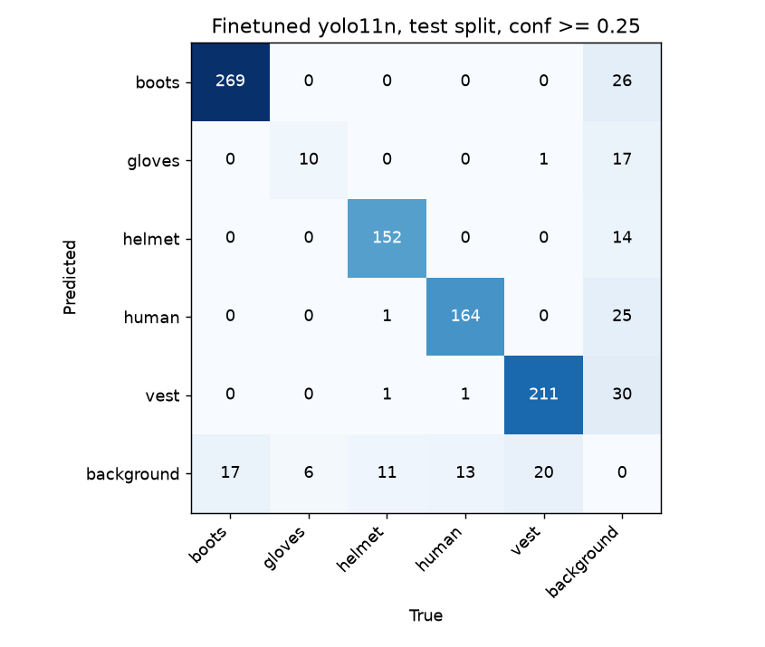
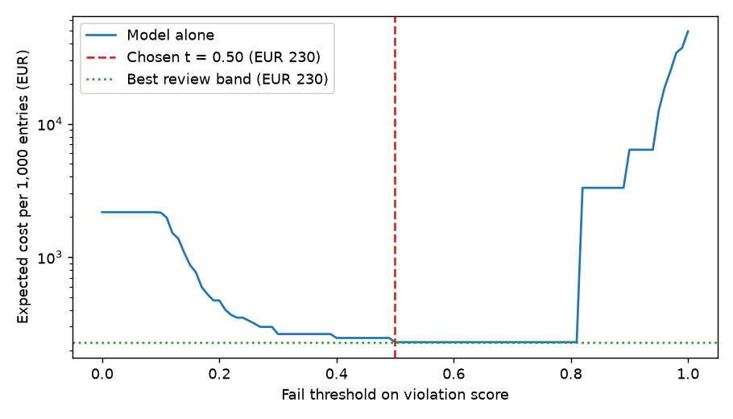

# Assignment 2 Report

- **Name**: Jaime Lopez Baillo
- **Student ID**: 19031
- **Email**: jlopezbaillo.ieu2022@student.ie.edu
- **Group**: BBADBA 5A

## Business problem, and the cost of being wrong

**The decision.** A construction company in Spain runs camera equipped turnstiles at the
entrance to its sites. Today a gate attendant or safety coordinator looks at each
worker coming in and decides: *let them on site, or stop them because they are not
wearing a helmet.* The model takes that look over. It gives one call per gate
entry: **pass**, **fail** (the turnstile refuses and the worker is sent back to
put a helmet on), or **review** (the image goes to the safety coordinator's screen
and they decide).

**Positive class:** an entry where at least one person in the image has no
helmet on their head.

**The two mistakes cost very different amounts.** The figures are set for Spain (taking into account the most accurate information about fines for not respecting the law):

| Outcome | Cost per entry | Why |
|---|---|---|
| False negative: helmetless worker let on site | **€2,400** | Failing to make workers use PPE is a *falta grave* (serious infringement), and €2,400 is about the bottom of the fine band for that. This treats every missed violation as if it were fined, which is a deliberately high figure: it ignores the chance that no inspector ever sees it, but it also leaves out injury costs and what we call in spain the recargo de prestaciones. I test it from €25 to €10,000 below. |
| False positive: compliant worker stopped | **€2.17** | 10 minutes of a worker's time (queue, re-scan, maybe a word with the coordinator) at **€13/h**. |
| True positive: helmetless worker stopped | **€2.17** | It is the same stop, but this time it is warranted. Even a perfect model pays it. |
| True negative | €0 | The worker walks through. |
| Human review | **€0.07** | 20 seconds of a safety coordinator at €13/h. |
| Reviewer error | 5% miss, 2% false alarm | People looking at a screen in a rush are not perfect. A reviewed violation therefore costs 0.07 + 0.05·2,400 + 0.95·2.17 = **€122.13**, and a reviewed compliant worker costs 0.07 + 0.02·2.17 = **€0.11**. |

A missed violation costs about **1,100 times** a wrong stop. So the operating point has to
push recall on violations as close to 1 as possible, and accept stopping some compliant
workers to get there. Everything below follows from this: the metric I care
about is violation recall at an acceptable false-stop rate.

## Dataset

- **Roboflow Universe:** workspace hx-hezqh, project ppe-detection-yfmym,
  **version 1**. <https://universe.roboflow.com/hx-hezqh/ppe-detection-yfmym/dataset/1>
  (CC BY 4.0, used as published, not forked).
- **Task:** object detection with 5 classes: boots, gloves, helmet, human, vest.
- **One image:** one or more workers on or near a construction site, from mixed
  sources (video frames, stock and web photos, phone pictures).

**Why it serves the problem rather than just looking like it.** The decision is
about *people*, not about helmets on their own. A helmet lying on a table should
not clear anyone, and in a group of three you need to know *which* person is bare-headed. This
dataset labels both `human` and `helmet` boxes, so I can tie each helmet to a
specific head. The dataset has no "no-helmet" class, so I derive the
ground truth: an image is a violation if some labelled `human` has no labelled
`helmet` whose centre lies in that person's head region . The model's score is built the same way
(`ppe_decision.py`). For each detected person, score = 1 − (best helmet
confidence in their head region), and the image takes its worst person.
`boots`, `gloves` and `vest` are trained and reported, but they do not feed
the decision.

## What the dataset's composition implies

**First finding: the published splits leak.** 185 of the 211 test images are
near-copies of a training image,
which is what you get when frames from the same videos are scattered across all
three splits. Training on the published split would have made the test set
measure memory, not generalisation. `train.py` keeps the test split exactly as
published and **drops every train/valid image that near-duplicates a test
image**:

| Split | Published | Kept | Dropped |
|---|---:|---:|---:|
| train | 1,566 | 832 | 734 (47%) |
| valid | 420 | 211 | 209 (50%) |
| test | 211 | 211 | 0 |

**Composition after de-duplication** (computed from the labels):

| | train | valid | test |
|---|---:|---:|---:|
| Images | 832 | 211 | 211 |
| Images with a person | 541 | 121 | **158** |
| …of which a violation (derived) | 101 (19%) | 32 (26%) | **39 (25%)** |
| `boots` instances | 1,063 | 244 | 286 |
| `gloves` instances | **64** | 38 | **16** |
| `helmet` instances | 760 | 159 | 165 |
| `human` instances | 703 | 187 | 178 |
| `vest` instances | 997 | 246 | 232 |

Median box area as % of the image (test): helmet **1.1%**, boots 0.7%, vest
5.4%, human 27.6%, gloves 37.3%. Train and valid are similar, except for gloves.

**What that implies:**

1. **Gloves cannot be trusted.** 64 training and 16 test instances is too few.
   And a median glove box of 19–37% of the image means most glove images are
   close-up product photos, a different kind of picture from the rest. Any
   number for gloves is noise. Gloves are not part of my decision, but they
   pull the mean AP down.
2. **Helmets are small.** A helmet takes up only about 1% of each image, roughly the size of an app icon once the image is resized for the model. That is still enough to detect, but a gate camera placed too far away or set too wide would make helmets even smaller and harder to spot. So where the camera goes is part of the design, not a detail.
3. **People fill about a quarter of the frame.** That matches a gate camera at close
   range quite well. That is the part of the test set that does look like
   production.
4. **The decision is evaluated on only 39 violations and 119 compliant images.**
   Recall measured on 39 positives is coarse: one miss moves it by 2.6 points.
   Zero misses out of 39 is still consistent with a true miss rate of up to
   about 3/39 ≈ 7.7% . At €2,400 per miss, this matters more than anything
   else in the cost analysis.
5. **The test mix is not the production mix.** 25% of test images with people
   are violations. At a real gate I assume 5%. I therefore never cost
   anything at the test set's prevalence: rates are measured on the test set and
   reweighted to the assumed base rate.
6. **The test set is still easier than production.** Hash de-duplication
   removes near-identical images. It does not remove neighbouring frames of
   the same video, so some scenes, people and backgrounds appear in both train and
   test.

## Finetuning and baselines

**Model:** `yolo11n` detection, finetuned from the COCO checkpoint. I used
detection, not classification, because the decision needs to know which
person has which helmet. A whole-image classifier cannot do that, and the
dataset has no image-level label to train one on. I used nano because it runs
on a cheap edge box at each gate. I did not train `yolo11s`, so I cannot claim it would not
do better.

**Training:** Google Colab GPU via train_colab.ipynb, which runs
the unchanged `train.py` (50 epochs, the default). Settings: image size 640, batch 8,
early-stopping patience 15, seed 0, `deterministic=True`. Trained on the
de-duplicated train split, with the de-duplicated valid split for checkpoint selection.
Best weights in `weights/ppe_yolo11n.pt`. When I changed the costs later, I
re-ran only the evaluation and costing on these same weights.

**Results on the same 211-image test split:**

| Model | mAP50 | mAP50-95 | Best cost per 1,000 entries |
|---|---:|---:|---:|
| **Finetuned yolo11n** | **0.853** | **0.626** | **€230** |
| COCO yolo11n zero-shot (`person` → `human`) | 0.162 | 0.096 | €2,170 |
| Predict nothing | 0.000 | 0.000 | €2,170 |

The zero-shot COCO model detects people well (human AP50 0.81) but has no helmet,
vest, boot or glove class, so it scores 0 on four of five classes. At the
decision level it cannot clear anyone, so its cheapest policy is to stop
everybody. The predict-nothing baseline ends up in the same place. With €2.17 per
stop and €2,400 per miss, stopping all 1,000 entries (€2,170) is far cheaper than
passing all of them (50 × €2,400 = €120,000). So the trivial baseline to beat is
"stop everyone", and the finetuned model costs about a tenth of it.

The gap is as large as expected. The COCO model is not a weak helmet detector.
It is not a helmet detector at all, so the finetuning is doing all of the work
that matters.

## Per-class evaluation and failure modes

Per-class precision and recall at confidence 0.25, and AP at IoU 0.5, for the finetuned model:

| Class | Test instances | Precision | Recall | AP50 | AP50-95 |
|---|---:|---:|---:|---:|---:|
| boots | 286 | 0.912 | 0.941 | 0.957 | 0.661 |
| gloves | 16 | **0.357** | **0.625** | **0.491** | 0.237 |
| **helmet** | 165 | 0.916 | 0.921 | 0.930 | 0.665 |
| **human** | 178 | 0.863 | 0.921 | 0.942 | 0.829 |
| vest | 232 | 0.868 | 0.909 | 0.946 | 0.738 |
| **mean** | | | | **0.853** | **0.626** |

**Which classes carry the headline.** The decision rests on `helmet` (AP50
0.93) and `human` (0.94). `gloves` drags the mean down: without it, mAP50 would be
0.944. The 0.853 headline undersells the classes that matter and overstates
the one class I would not trust.

**Confusion matrix** (`artifacts/confusion_matrix.png`, IoU 0.5, conf ≥ 0.25):

The classes are almost never confused with each other. There are four
cross-class errors in total, for example one helmet called a human and one vest
called gloves. All the other errors are against background:

- **Missed objects** (bottom row): 11 of 165 helmets (6.7%), 13 of 178 people (7.3%),
  17 boots, 20 vests, 6 of 16 gloves.
- **Detections on background** (right column): 14 helmets, 25 people, 26 boots, 30 vests, 17 gloves.

**Which detector errors cost what.** They are not equal:

- A **missed helmet** makes a compliant worker look bare-headed. That gives a
  false stop: **€2.17**.
- A **false helmet on a bare head**, or a **missed person in a group**, hides a
  violation. That gives a missed violation: **€2,400**. This is the error to watch.

**At the decision level:** 
All 39 violations are stopped, and 7 of 119 compliant entries are stopped
(5.9%). I looked at every one of those 7 false stops and the violations with
the lowest scores:

| What went wrong | Count | Example |
|---|---:|---|
| **No person detected**, so by design the image scores 1.0 and fails, even though a helmet *was* detected at 0.39–0.87 | 4 | image_163, image_196, image_219, 105_JPG |
| Person and helmet both detected (0.81, 0.90), but the helmet centre fell outside my head region of the person box | 1 | Video1_163 |
| Helmet missed (best confidence 0.02–0.04) | 2 | ppe_0320, download-1- |

**The closest call** My closest call was a worker without a helmet where the model thought it saw a helmet on their head, but it was only 19% sure. That still gave a high violation score, so the worker was stopped. But it shows the dangerous kind of mistake: if the model had imagined that helmet with 50% confidence or more, the worker would have been let through. Seeing a helmet that isn't there is the error that costs €2,400.

So the weak point is not the helmet detector itself. It is the step that
turns boxes into a decision: "no person found" and the head-region geometry
cause 5 of the 7 false stops.

## Cost matrix and operating point

**Costs** are in the first section. **Base rate: 5%** of gate entries without a
helmet. This is an assumption: the test set's 25% reflects how the dataset was
collected, not a real site. So I measure the model's error rates on the test set
and apply them to a 5% base rate.

**Sweep.** I tried every threshold from 0 to 1 in steps of 0.01 and calculated the
expected cost per 1,000 entries for each (`artifacts/cost_sweep.csv`):

- **Too low** (below 0.50): too many compliant workers are stopped. At 0 everyone
  is stopped, which costs €2,170.
- **Between 0.50 and 0.81:** the cost is at its minimum, **€230 per 1,000**. All 39
  violations are caught and 5.9% of compliant workers are stopped. The curve is
  flat because no test image scores in that range.
- **Too high** (above 0.81): violations start getting through, and the cost jumps
  straight to €3,304.

**Chosen threshold: 0.50.** The whole flat range costs the same on the test set, so
I take the end furthest from where violations start slipping through. A miss costs
1,100 times a wrong stop.

Of the €230, €108 is stopping the real violators, which even a perfect model would
pay. The other €121 comes from wrongly stopping compliant workers.

**Does the threshold depend on my assumptions? No.** I re-ran the sweep with the
base rate anywhere from 1% to 18%, and the cost of a miss anywhere from €25 to
€10,000. The best threshold stayed at 0.50 every time. Only the total cost changed
(from €148 to €495 across the base rates). So even if most misses are never fined,
the decision is the same.

**The assumption that would change the answer** is that the model misses no
violations, which is measured on only 39 of them. The model is only cheaper than
stopping everyone if it misses fewer than **1.6%** of violations, about 1 in 62.
The test set cannot prove that, and the real miss rate could be as high as 7.7%,
which would make the system about 40 times more expensive. That is why measuring
it on real gate images comes first (see the limitations).

## What a person still has to check

My two thresholds: pass below 0.50, fail at 0.50 or above. Nothing goes to review.
I tried every possible pair of thresholds, and the cheapest one has no review
band at all (€230 per 1,000 entries). There are two reasons:

**There is nothing to review on the test set.** Every compliant worker who is
   let through scores 0.49 or less, and every violation scores 0.815 or more.
   No test image lands in between.

**A person is not a better safety net here.** Checking an image only takes 20
   seconds (€0.07), but if the reviewer misses 5% of violations, each reviewed
   violation carries 5% × €2,400 = **€120** of expected fine. An automatic stop
   costs €2.17. So when in doubt, stopping the worker is much cheaper than asking
   someone. Review only becomes the cheapest option when a miss costs as little
   as €25.

**Where a person is still needed: checking the model, not the workers.** The
weakest number in this report is the miss rate (0 out of only 39 violations).
So the safety coordinator checks a random sample of 300 passed entries a day,
outside the rush, to catch any violations the model let through and to notice if
it gets worse (new cameras, winter clothing, a new site). At 20 seconds each, that
is 1.7 hours a day, about a quarter of one coordinator's shift, for €21. This
is realistic without hiring anyone. If the audit shows the model missing more than
about 1.6% of violations, the thresholds have to be revisited.

**The real workload is the stops, not the reviews.** About 150 justified and 168
wrong stops a day, half of them in the morning rush. A compliant worker gets
stopped by mistake about once every 8–9 working days. That is what site
management will complain about, and the main reason to fix the failures above.

**Compared with the alternatives** (5% of workers without a helmet, 3,000 entries a day):

| Option | Cost per 1,000 | Cost per day |
|---|---:|---:|
| Do nothing | €120,000 | €360,000 |
| A person checks everyone | €6,214 | €18,643 |
| Stop everyone | €2,170 | €6,510 |
| **Model alone** | **€230** | **€689** |
| **Model + daily audit** | **€237** | **€711** |

A person checking everyone costs 27 times more, needs 17 people during the rush,
and still lets 2.5 helmetless workers in per 1,000 because people make mistakes.
The model saves much more a day compared with that, as long as it really
misses fewer than 1.6% of violations. That is exactly what the audit checks.

## Limitations & next steps

**Too few violations to be sure.** The model caught all 39 violations in the
   test set, but 39 is a small number, and the real miss rate could be more. The next step will be to test it on more real photos from the gate cameras,
   running it alongside the current manual check before relying on it.

**"No person found" always means a stop.** This caused 4 of the 7 wrong stops,
   even though the model had seen a helmet in each of those photos. 

**The rule that links a helmet to a head is fixed.** It looks for the helmet in
   the top part of the person, and in one photo the helmet fell just outside that
   area.

**Gloves are not reliable.** There are only 16 in the test set, mostly in close-up
   photos. They are not used in the decision. So the next step will be to remove the class, or find
   better glove images.

**The euro figures are estimates.** The fine, the €13/h wage and the 5% of workers
   without a helmet are my assumptions. The threshold stays at 0.50 whatever they
   are, but the total cost does change. The next step will be to use the company's real fine, wage
   and incident data.

## Generative AI use disclosure

I used Claude code as a coding assistant during this assignment. It wrote most of the code, including the training, and the main file, and fixed the errors. It help to plot the results too. It was helpful for the Gradio dashboard like for the past assignment. I also used it sometimes to understand concepts and get ideas about what to analyze in order to improve the results. And finally I also used to improve the formatting of the report.

